# 回转器（Gyrator）电路与相关知识的学习笔记

前段时间发现了一种用于音频电路中的回转器电路，这个电路在我们前段时间的抄板工作中经常见到，设计的非常巧妙。作为补充，我简单的学习了一下与只相关的一些知识和概念，写了以下的学习分享。然而我得水平有限，对其中有些地方的理解还有些模糊，文章中可能有一些不准确的地方，请大家批评指正。

---

# 一、基础知识

## 回转器（Gyrator）的理论提出

1948年，贝尔实验室的**伯纳德·特勒根 ( B.D.H. Tellegen)在飞利浦研究实验室工作时，发表了一篇开创性论文: 《The Gyrator, a New Electric Network Element》**

他从纯数学和电路理论的角度，“发明”了电子学意义上的回转器：

1.  **提出了第五种理想电路元件**：在电阻、电容、电感和理想变压器这四种经典线性元件之后，他首次从数学和拓扑的完备性出发，提出了作为**第五种理想线性元件**的回转器。
    
2.  **定义了非互易性**：他指出回转器最本质的特征是**非互易** ——其电压和电流的传输方向不可随意互换，这与前四种互易元件有着根本区别。
    
3.  **给出了理论模型和符号**：他不仅给出了回转器的理想数学模型，还发明了一个电路符号，并提出了几种可能实现的物理方式，例如用一个特殊的磁环结构来近似
    

## 核心定义：什么是回转器？

理想回转器是一个线性、无耗的双端口网络，它的独特之处在于**非互易性**。其端口电压和电流的关系由以下方程定义：

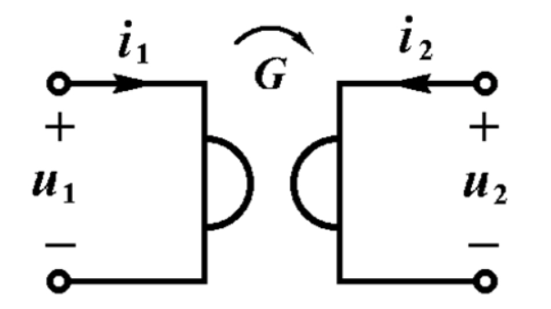

$v\_1 = r \cdot i\_2$

$v\_2 = -r \cdot i\_1$

这个方程将一个端口的电压与另一个端口的电流联系了起来。正是这种“电压⇌电流”的关系，带来了一个电路特性：**阻抗反转**。

如果在回转器的端口2接入一个阻抗Z2，那么从端口1看进去的输入阻抗Z1就变成了：

$Z\_1 = \frac{v\_1}{i\_1} = \frac{r \cdot i\_2}{\frac{v\_2}{-r}} = \frac{r^2}{Z\_2}$

如果接入的阻抗Z2是一个电容元件C，那么上述的输入阻抗就可以写作：

$Z\_C = \frac{1}{j \omega C}$

$Z\_1 = \frac{r^2}{Z\_2} = r^2 j \omega C$

这样一来，阻抗就具有了电感的特性，也就是说，回转器把一个电容变成了一个感值为$r^2 C$的“电感”。

## 为什么要这样做

1.  **物理电感制造难**：物理电感在集成电路中难以微型化，且存在损耗大、易受干扰等固有限制。
    
2.  **利于集成**：回转器能用易于集成的电容和运放等有源器件来“模拟”电感，实现体积小、成本低、性能可精确设计、感值可电控调节的优势，也可以模拟出大感值的“电感”。
    
    *   作为有源阻抗变换器：用有源器件（运放）和阻容元件“模拟”电感行为。
        
    *   经典应用：模拟电感（Simulated Inductor），也称有源电感（Active Inductor）。
        

# 二、模型与数学推导

上述的Gyrator只是一个理论模型，受限于当时的技术，Tellegen本人也没能造出一个真实可靠的回转器电路。但是在接下来的研究中，工程师们一步一步发现了用有源器件来制造真实的回转器的方法。

## 1. NIC（Negative Impedance Coverter，负阻抗变换器）—— 思想的源头

1953年，林维尔（J. G. Linvill）在它的论文 **《Transistor Negative-Impedance Converters》** 中，提出了**负阻抗变换器(NIC)**，实现了：

$Z\_{in} = -k \cdot Z\_L$

我找到了另一篇文章详细的讲解了NIC电路的推导，文章较长，我还没咋完全看懂，这里贴上链接供大家参考：

[https://wikibooks.cn/wiki/Circuit\_Idea/Negative\_Impedance\_Converter](https://wikibooks.cn/wiki/Circuit_Idea/Negative_Impedance_Converter)

*   两种类型：VNIC（电压反转）与 INIC（电流反转）\[^3\]
    
*   直观理解：负阻抗 = “响应与激励方向相反”
    
*   为什么需要负阻抗：补偿损耗、维持振荡、构建非互易元件
    

**下图展示了两种NIC电路**

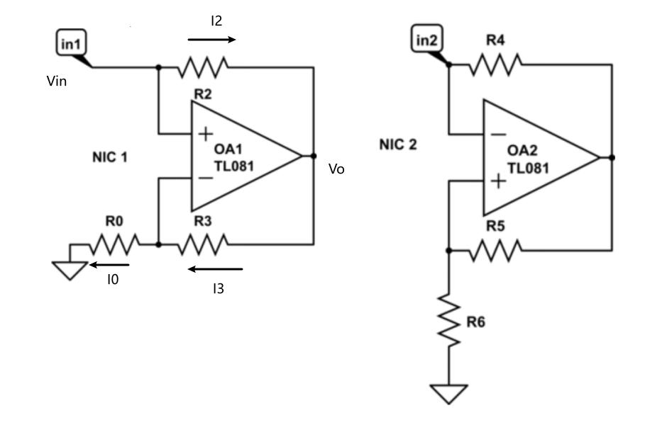

阻抗公式推导如下（NIC1）： 设运放同相、反相输入端和输出端的电压分别为 $V\_+, V\_-, V\_o$由虚短：$V\_- = V\_+ = V\_{in}$流过 $R\_2$ 的电流：

$I\_{2} = \frac{V\_{in} - V\_o}{R\_2}$

流过$R\_3$的电流：

$I\_{3} = \frac{V\_{o} - V\_{in}}{R\_3}$

流过$R\_0$的电流：

$I\_0 = \frac{V\_{in}}{R\_0}$

由虚断（流入反相端的电流为0）：

$I\_0 = I\_3 \quad \Rightarrow \quad \frac{V\_{in}}{R\_0} = \frac{V\_{o} - V\_{in}}{R\_3} \quad \Rightarrow \quad V\_o = V\_{in} (1+ \frac{R\_3}{R\_0})$

同理：

$I\_{in} = I\_{2} = \frac{V\_{in} - V\_o}{R\_2}$

带入$V\_o$，得

$I\_{in} = -\frac{R\_3}{R\_0 R\_2} V\_{in}$

因此从输入端看到的阻抗为：

$Z\_{in1} = \frac{V\_{in}}{I\_{in}} = -\frac{R\_0 R\_2}{R\_3}$

若将R2看作负载阻抗$Z\_L$，则：

$Z\_{in1} = -\frac{R\_0}{R\_3}  \cdot Z\_L = -k\cdot Z\_L$

NIC2的阻抗公式推导同理，结果如下，推导过程在此不做赘述。

$Z\_{in2} = -\frac{R\_4 R\_6}{R\_5}$

值得注意的是，上面这两种电路的接法相当于同时将输出正反馈和负反馈回到运放的输入，因此想要这个**电路稳定是需要条件的**。比较直观的理解如下： 对于NIC1电路，我们叫他**短路稳定型**，即输入源需要是低阻抗（甚至是短路到地）的，这样运放正反馈到同相输入端的电压基本被拉到地，因此负反馈一路占主导作用，此时电路才能形成稳定的负反馈。 同理对于NIC2电路，叫做**开路稳定型**。即输入源要是高阻抗（甚至是开路）。此时输出端的变化能全部通过R4负反馈到反相输入端，电路形成稳定的负反馈。

直接将上面两个NIC电路串联，用NIC2代替NIC1中的负载R0，就得到了最直观的GIC电路：

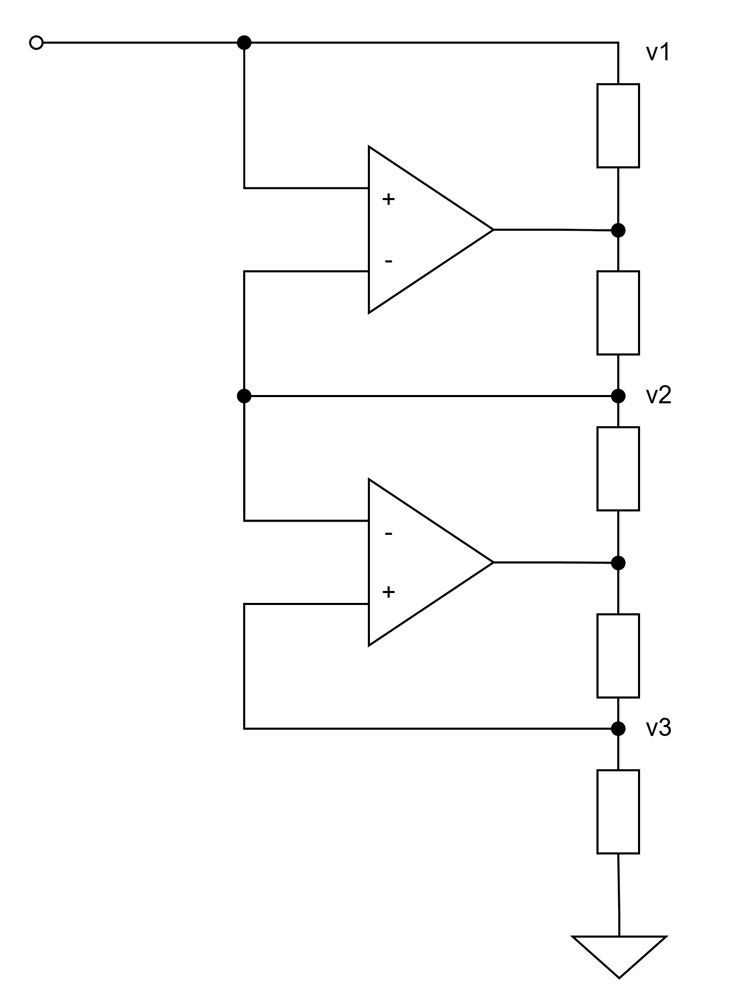

## 2. GIC（Generalized Impedance Converter，通用阻抗变换器）

GIC是安东尼乌（A. Antoniou）与1969年提出的一种电路，如下图。这个电路就是改进了上面的GIC电路，演化而来的。其思路就是，对于满足虚短虚断的运放，其同相输入端和反相输入端的电压是相等的，既然两个节点电位相同，你把它们的位置互换，电路的行为不会改变。于是经过交换，理清楚的电路就是下图的形式。

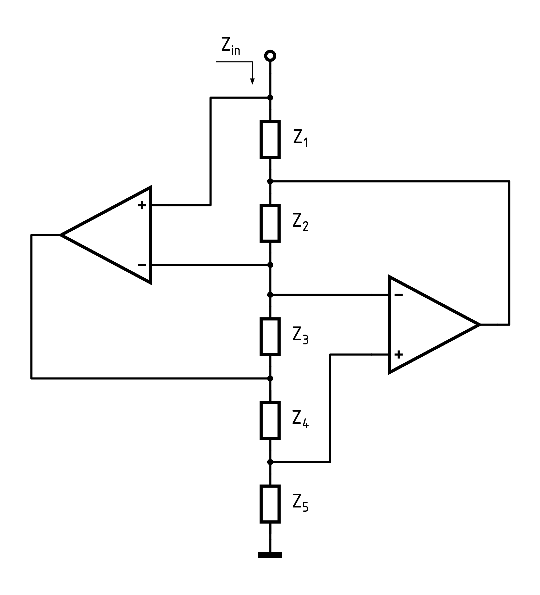

其阻抗公式为

$Z\_{in} = \dfrac{Z\_1 Z\_3 Z\_5}{Z\_2 Z\_4}$

通过选择不同元件组合，电路可“变出”多种阻抗特性。显然这个电路已经具备了将电容“变成”电感的能力：只要将$Z\_2$或者$Z\_4$设置为电容，则电路总体的输入阻抗就会呈现出电感的特性。

这个电路是一个通用的电路，既可以用来模拟电感，也可以用作FDNR（频变负阻）。（FDNR频变负阻在实际电路中的一个重要应用也是用电阻电容来模拟电感元件的特性，从而制作无电感的高阶滤波器）

## 3. Gyrator（回转器）与有源电感

在实际工程中，还有一种更为常用的模拟电感电路。

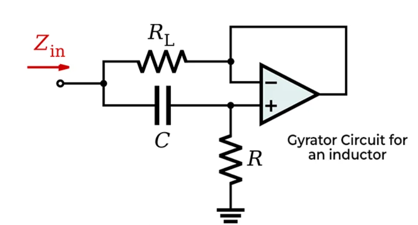

模拟电感，又称有源电感。它利用一个运算放大器（Op-Amp）和几个无源元件，在输入端“模拟”出一个电感的特性。

### 公式推导

为了方便运算，上图可以化成这样

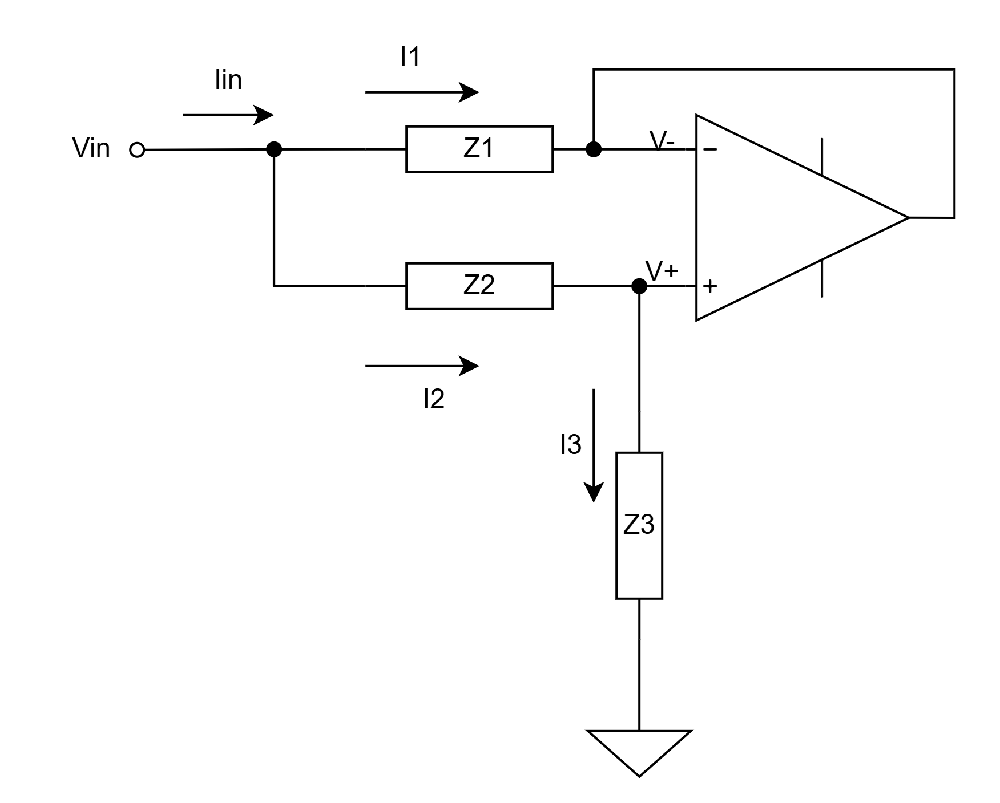

$I\_{in}=I\_1 + I\_2$

$I\_1 = \frac{V\_{in}-V\_-}{Z\_1}$

$I\_2 = \frac{V\_{in}-V\_+}{Z\_2}$

$I\_3 = I\_2 = \frac{V\_+}{Z\_3}$

$V\_1 = V\_- = V\_+ = I\_2 \cdot Z\_3 = \frac{V\_{in}-V\_+}{Z\_2} \cdot Z\_3 \quad \Rightarrow \quad (1+\frac{Z\_3}{Z\_2}) \cdot V\_1 = \frac{Z\_3}{Z\_2} \cdot V\_{in}$

$\quad \Rightarrow \quad V\_1 = \frac{Z\_3}{Z\_2 + Z\_3} \cdot V\_{in}$

$I\_{in} = I\_1 + I\_2 = \frac{V\_{in}-V\_-}{Z\_1} + \frac{V\_{in}-V\_+}{Z\_2} = (V\_{in} - V\_1)(\frac{1}{Z\_1}+\frac{1}{Z\_2})$

带入$V\_1$，化简得，

$Z\_{in} = \frac{V\_{in}}{I\_{in}} = \frac{Z\_1Z\_2+Z\_1Z\_3}{Z\_1+Z\_2} = (Z\_2+Z\_3)\parallel(Z\_1+\frac{Z\_1Z\_3}{Z\_2})$

也就是说，上述电路等效为：

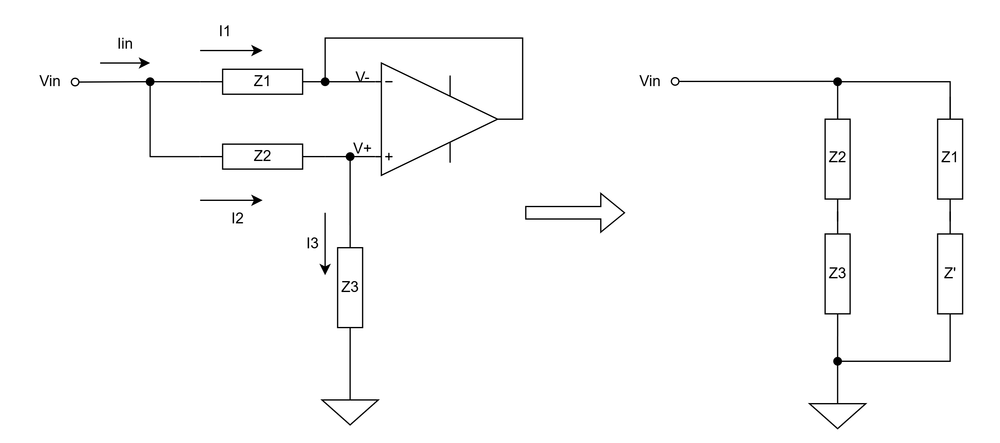

其中，

$Z' = \frac{Z\_1Z\_3}{Z\_2}$

显然，如果取$Z\_2$为电容，那么$Z'$表现出的特性就相当于一个电感。 因此最开始那个电路，等效于下图，其中等效电感为

$Z\_L = \frac{R\_L R}{Z\_C} \quad \Rightarrow \quad j\omega L = \frac{R\_L R}{\frac{1}{j \omega C}} = j\omega C R\_L R \quad \Rightarrow \quad L=C R\_L R$

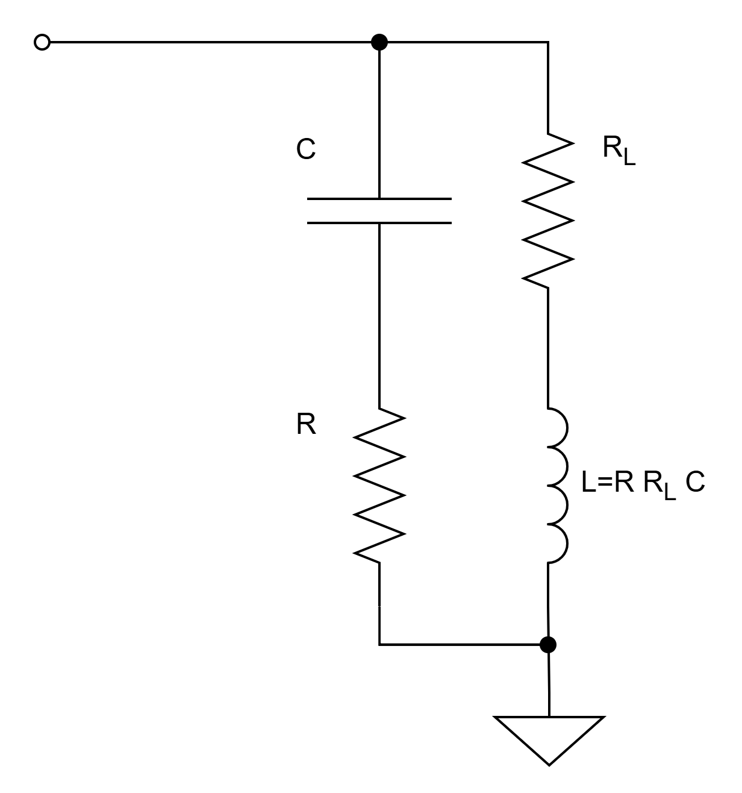

### 仿真验证

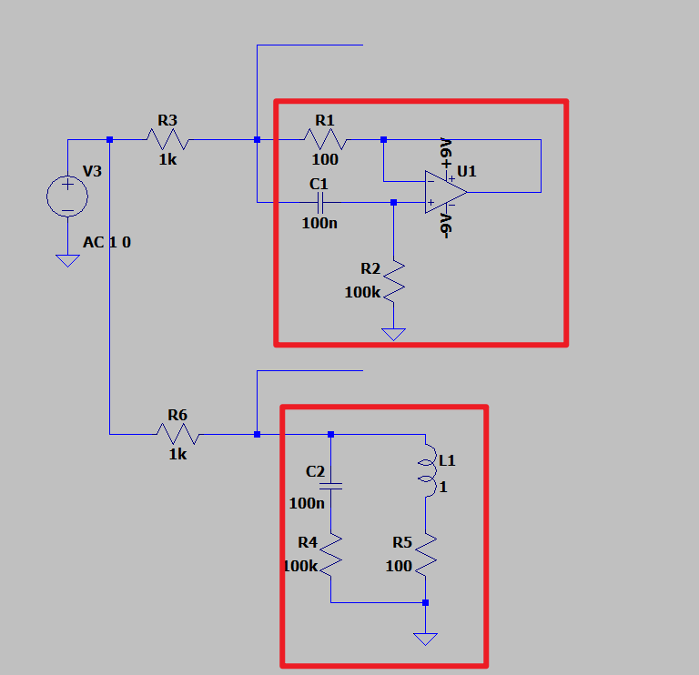

如图中上半部分为运放构成的模拟电感电路，带入上述公式分析，可以计算得到等效电感为：

$L=C R\_L R = 100\*100n\*100k =1$

从仿真结果来看，两个电路确实是等效的。

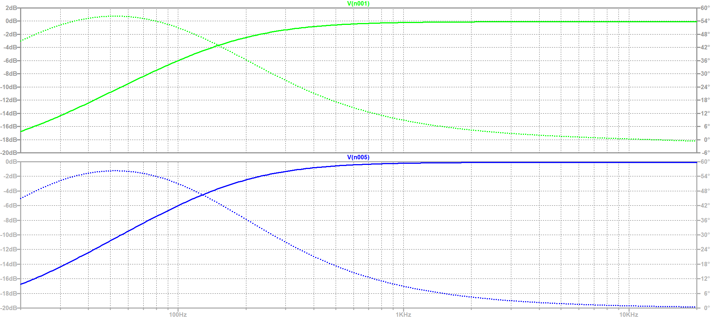

一篇参考文章中还给出了一种有源电感的电路，也能够用来模拟电感元件。

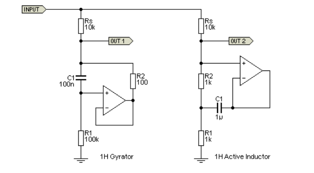

[https://sound-au.com/articles/gyrator-filters.htm#s13](https://sound-au.com/articles/gyrator-filters.htm#s13)

上图右侧所示的有源电感电路，经公式推导得到的等效阻抗公式为：

$Z\_in = R\_1+R\_2+\frac{R\_1 R\_2}{Z\_{C\_1}} = R\_1+R\_2+j\omega R\_1R\_2C\_1$

详细推导过程与上述回转器的推导类似，这里不做赘述。可见右侧的电路可以等效为电阻串联电感。下图的仿真结果证实了这个等效。

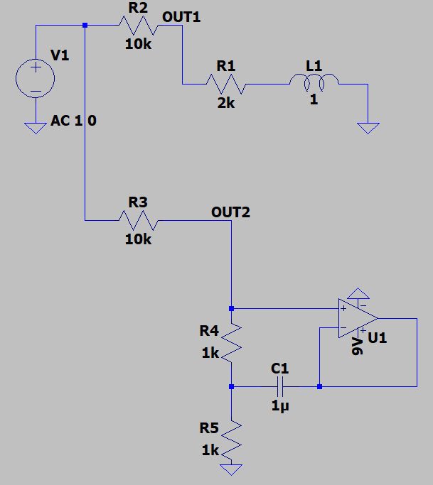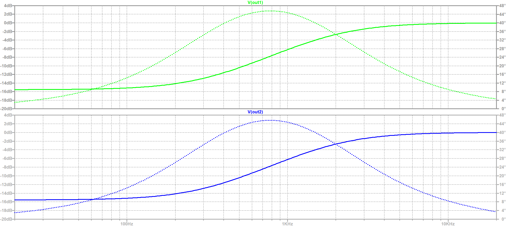

# 三、音频滤波电路中的具体应用

## 应用：多段EQ电路

模拟电感最常用的一个功能就是用作滤波器，而多段EQ电路实际上就是多个带通/带阻滤波器的组合。 

## 补充应用：GIC电路的应用——FDNR（频变负阻）

前面的GIC电路中有5个阻抗元件Z1~Z5，我们可以任意将其替换成电阻、电容或电感，来组合出“新元件”。 例如将Z2（或者Z4）设定为电容，其他为电阻，则

$Z\_{in} = \frac{Z\_1 Z\_3 Z\_5}{Z\_2 Z\_4} = \frac{R\_1 R\_3 R\_5 \cdot j\omega C}{R\_4} = j \omega L$

$L = \frac{R\_1 R\_3 R\_5  C}{R\_4}$

如果Z1和Z5为电容，其他为电阻，则有

$Z\_{in} = \frac{Z\_1 Z\_3 Z\_5}{Z\_2 Z\_4} = \frac{(\frac{1}{j\omega C\_1})R\_3 (\frac{1}{j\omega C\_5})}{R\_2R\_4} = -\frac{1}{\omega^2 D}$

$D = \frac{C\_1C\_5R\_2R\_4}{R\_3}$

这个$D$元件就是一个频变负阻抗元件。它的阻抗与

有关，因此频响曲线会比电感更陡峭，可以用在高阶滤波器电路中。

以下展示一种FDNR构成的滤波器，详细分析在此不做展开，大家有兴趣可以参考这篇文章进行进一步的学习：

[https://blog.csdn.net/xeonmm1/article/details/80875334](https://blog.csdn.net/xeonmm1/article/details/80875334)

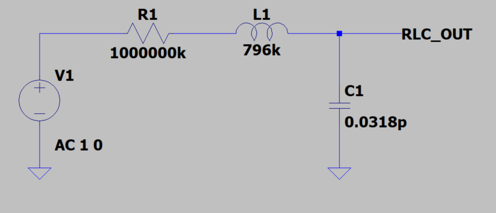

上图是一个由RLC组成的无源低通滤波器电路。它的频响如图。可见如果使用这种RLC电路构成这样的滤波器，所需要的电感电容值是现实中不可能获得的。

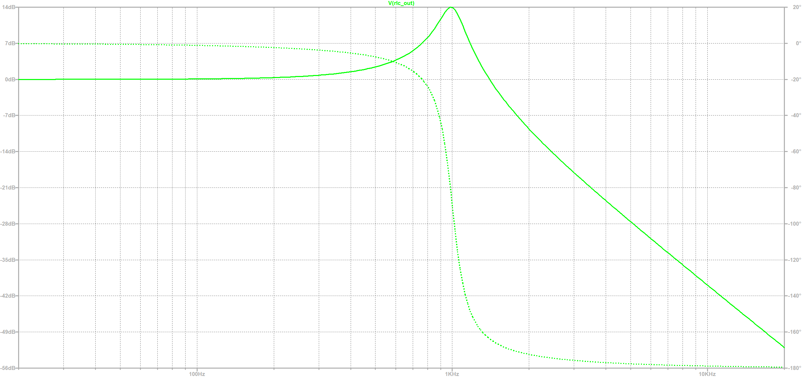

我们将R、L和C分别除以$j\omega$，则有

$R \quad \Rightarrow \quad \frac{R}{j\omega}$

$j\omega L \quad \Rightarrow \quad L$

$\frac{1}{j\omega C} \quad \Rightarrow \quad -\frac{1}{\omega^2 C}$

这相当于把原电路中的电阻R变成了值为$\frac{1}{R}$的电容，电感L变成了电阻，电容C则可以用上述频变负阻代替，因此电路可以等效于下图。

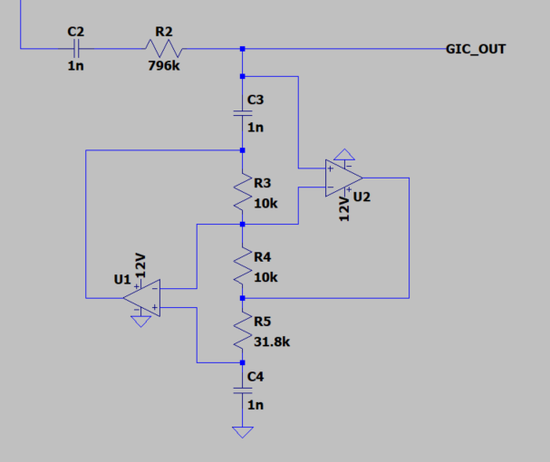

通过仿真对比，可以发现两个电路完全等效。

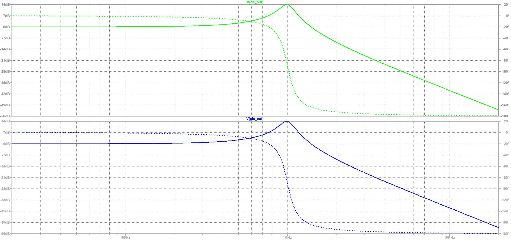

---

以上内容就是到目前为止我初步学习的成果，但实际上这些NIC、GIC和Gyrator电路还有很多变体和有意思的应用，下面列出来了我学习时找到的参考网站和资料，大家有兴趣也可以看一看。

## 参考链接
[Negative Impedance Converter - Circuit Cellar](https://circuitcellar.com/resources/quickbits/negative-impedance-converter/)

[Equivalent Inductor Equation (Antoniou Gyrator Proof)](https://electronics.stackexchange.com/questions/381808/equivalent-inductor-equation-antoniou-gyrator-proof)

[负阻抗变换器和回转器 - 豆丁网](https://www.docin.com/p-672244424.html)

[Gyrators - Circuit Cellar](https://circuitcellar.com/resources/quickbits/gyrators/)

[Gyrator Filters （推荐阅读）](https://sound-au.com/articles/gyrator-filters.htm)

[电路创意/负阻抗转换器 - 华夏公益教科书，开放的书籍，开放的世界](https://wikibooks.cn/wiki/Circuit_Idea/Negative_Impedance_Converter)

[https://www.docin.com/p-672244424.html](https://www.docin.com/p-672244424.html)

[在 LTSpice 中使用的旋转器计算器，可用于图形均衡器的设计——适用于 DIY 音频处理。 --- A gyrator calculator in LTSpice for graphic EQ design | diyAudio](https://www.diyaudio.com/community/threads/a-gyrator-calculator-in-ltspice-for-graphic-eq-design.419423/)

[Gyrator-based Filter Circuits | Springer Nature Link](https://link.springer.com/chapter/10.1007/978-1-349-21311-5_7)

[吉他效果器：振频滤波器计算器 --- Guitar Pedals: Gyrator Filter Calculator](https://www.muzique.com/lab/gyrator.htm)

[Gyrator Filters](https://sound-au.com/articles/gyrator-filters.htm#s13)

[Active Filters](https://sound-au.com/articles/active-filters.htm)
